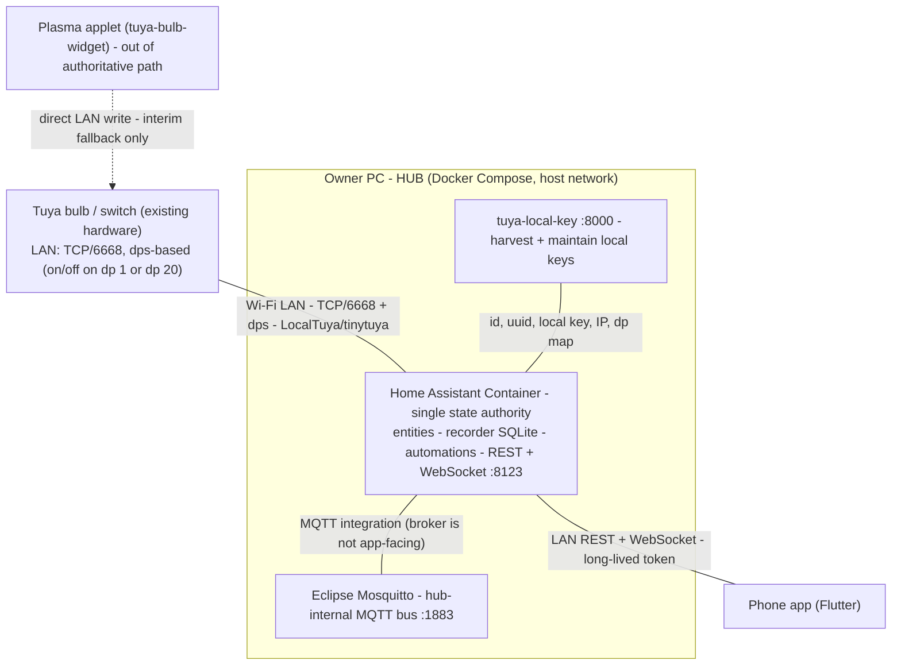

# Hosting Architecture

## Problem

The ecosystem has to live somewhere concrete. The owner's sketch left the runtime unspecified: which process holds state, which network leg each component uses, what runs on the PC versus the phone, and what breaks when a piece is down. Without a pinned topology, device discovery fails behind Docker NAT, address mappings drift with DHCP, and "the hub" becomes an unverifiable collection of containers.

## Solution

Three Docker Compose services run on the owner's existing PC, which doubles as the always-on server:

- **Home Assistant Container** - the hub and single state authority.
- **Eclipse Mosquitto** - the hub-internal MQTT bus.
- **tuya-local-key** - credential harvest and maintenance.

### Layer model

Two honest network legs plus one internal bus. The device leg is the Tuya LAN protocol on TCP/6668; the app leg is Home Assistant's REST + WebSocket API. MQTT never leaves the hub. See [[adr-0003-tuya-lan-protocol-over-mqtt-device-leg]] for why the device leg is not MQTT.



### Component inventory

| # | Component | Role | Where it runs | Talks to |
| --- | --- | --- | --- | --- |
| C1 | Home Assistant Container | Single state authority: entity state, recorder (SQLite) history, automations, REST + WebSocket API, MQTT integration, LocalTuya | Owner's PC, `network_mode: host` | Tuya devices (LAN), Mosquitto, the app |
| C2 | Eclipse Mosquitto | Hub-internal MQTT bus for MQTT-native devices and future extensions | Owner's PC, `:1883` | Home Assistant (MQTT integration) and MQTT-native devices |
| C3 | tuya-local-key | Harvests and maintains Tuya local keys; detects silent rotations | Owner's PC, `:8000` | Tuya cloud (provisioning) and the owner's browser; feeds C1 |
| C4 | tuya-bulb-widget | Provisioning/inspection evidence (dp discovery) plus interim desktop fallback | Owner PC (Plasma applet) | Tuya devices (LAN), directly |
| C5 | Phone app (Flutter) | Thin Home Assistant client: REST commands, WebSocket live state | Phone / desktop | Home Assistant only |
| C6 | This repo | Design corpus plus the deployed `deploy/` hub stack | n/a | n/a |

### Hosting topology

All three services run under one Compose project on the PC, started by a systemd unit that wraps `docker compose up -d`; every service carries `restart: unless-stopped`, so the stack comes back after a reboot or container crash.

The unit **requires the volume that holds the repository to be mounted**
(`RequiresMountsFor=`): the compose file and the whole Home Assistant config
volume live there, so a cold boot that starts the unit before the disk is
mounted would find no compose file and bring the stack up against the wrong
config. With the dependency the unit simply does not start while the disk is
absent — a hub that is down is visible, a hub running against the wrong config
is not. That is also why the data disk is a mount, not a plain directory: the
hub's own configuration has to survive a reboot of the machine, and a mounted
volume is what the owner controls.

Home Assistant runs with `network_mode: host` because LocalTuya needs UDP 6666/6667 broadcast, TCP/6668, and mDNS - Docker bridge NAT breaks device discovery. Mosquitto and tuya-local-key can stay on the default bridge because they only need TCP ports published to the LAN or to loopback.

```yaml
# Illustrative only - the real manifests live in deploy/.
# Images are pinned by digest; the readable tag is kept next to the pin.
services:
  homeassistant:
    # tag: stable
    image: ghcr.io/home-assistant/home-assistant@sha256:33afb0659d786213264c2211f8d91c5fe87461c56eba6a3a546eb05fc71e89f4
    network_mode: host          # LocalTuya needs UDP 6666/6667 broadcast, TCP/6668 and mDNS
    restart: unless-stopped
    volumes:
      - ./ha-config:/config
  mosquitto:
    # tag: 2
    image: eclipse-mosquitto@sha256:38c0da4f2ef84284d47b3b3eeea1cb3bdeabe81ee10caf0cd5c5ff61ee3ea408
    ports:
      - "1883:1883"
    restart: unless-stopped
    volumes:
      - ./mosquitto:/mosquitto/config
  tuya-local-key:
    # tag: latest
    image: ghcr.io/vineetchoudhary/tuya-local-key@sha256:95d50ec31f38f81d3161e0f9f36855e240171f2bdf6bd2891319ca18e6dc54b2
    ports:
      - "127.0.0.1:8000:8000"   # loopback only, or set AUTH_USERNAME / AUTH_PASSWORD
    restart: unless-stopped
    env_file:
      - .env                    # holds AUTH_USERNAME / AUTH_PASSWORD when auth is enabled
    volumes:
      - ./tuya-local-key-data:/data
```

| Port | Service | Exposure |
| --- | --- | --- |
| `8123` | Home Assistant REST + WebSocket | LAN (the app and a browser) |
| `1883` | Mosquitto MQTT | LAN (MQTT-native devices only; never app-facing) |
| `8000` | tuya-local-key | Loopback only, or Basic Auth when deliberately exposed |

Static DHCP leases (reservations by device MAC) keep every Tuya device's IP stable, so LocalTuya's per-device IP mappings survive reboots and reconnects.

**Images are pinned by digest, never by tag.** A tag moves under you — `stable` is
a rolling tag — and a silent upgrade of Home Assistant changes the hub's
behaviour with nobody deciding it. The pin freezes the version; moving it is a
deliberate act, and `[[bring-up-the-hub]]` carries the bump procedure. The
readable tag stays next to each pin so a human can tell what is pinned.

**The backup is scheduled, not remembered.** `deploy/scripts/backup.sh` writes
one 0600 archive of the hub's configuration, and
`deploy/systemd/daver-backup.timer` runs it daily at 03:30 — catching up after
a downtime rather than silently skipping a night. The destination must be a
**mounted volume**, ideally on a different physical device than the source disk:
the archive carries the owner account, the access tokens and the LocalTuya
local keys, so a copy next to the thing it backs up protects nothing, and the
unit refuses to run against a plain directory. The script never deletes
anything, so the archives are pruned on the owner's own schedule.

**Images are pinned by digest, never by tag.** A tag moves under you — `stable` is
a rolling tag — and a silent upgrade of Home Assistant changes the hub's
behaviour with nobody deciding it. The pin freezes the version; moving it is a
deliberate act, and `[[bring-up-the-hub]]` carries the bump procedure. The
readable tag stays next to each pin so a human can tell what is pinned.

### State ownership and data flow

| Fact | Owner | Direction |
| --- | --- | --- |
| Tuya device on/off/brightness/colour | Home Assistant (via LocalTuya) | hub -> device, the only writer of hub-managed bulbs |
| MQTT-native device state | The device, via the broker | device -> Mosquitto -> HA MQTT integration -> HA entity |
| App commands | The app | app -> HA REST/WebSocket -> device |
| History | Home Assistant recorder (SQLite) | HA -> SQLite |

Down behaviour:

- **Home Assistant down.** The app shows "hub unavailable" and resubscribes when HA returns. It never silently queues commands: state cannot be confirmed while the authority is down.
- **Mosquitto down.** MQTT-native entities go unavailable via their LWT; Tuya devices keep working because they never touch the broker.
- **tuya-local-key down.** No effect on control; only provisioning and key refresh pause.

### Stack choices with rationale

| Choice | Why | Rejected alternative and why |
| --- | --- | --- |
| Home Assistant Container | Mature entity model, recorder, automations, auth, REST + WebSocket out of the box | A custom Node backend - would rebuild the entity model, history store, auth, and push layer for no gain |
| Eclipse Mosquitto | Small, proven broker for MQTT-native devices and future extensions | HA's embedded broker or no broker - would force MQTT-native devices through HA internals and block clean extensions |
| LocalTuya (via HACS) | Local LAN control with explicit dps mapping; no cloud at runtime | tuya-bulb-widget as the primary control path - single-purpose, and its direct writes leave HA state stale |
| Flutter for the app | One codebase for phone and desktop; thin HA client | Per-platform native apps or a browser UI - more work for a stateless view over HA's API |
| Docker Compose on the existing PC | Reuses hardware the owner already runs; the PC does other work too | A Home Assistant OS appliance - needs a dedicated machine and gives up the shared PC |
| SQLite recorder | Built-in history, zero extra service to run and back up | A separate database (PostgreSQL/InfluxDB) - another service to operate for no current need; deferred, not rebuilt |

### What changed from the original sketch

1. **MQTT device leg -> LAN LocalTuya.** Tuya devices do not speak MQTT; they speak TCP/6668 with dps, reached through LocalTuya ([[adr-0003-tuya-lan-protocol-over-mqtt-device-leg]]). Mosquitto stays, but as an internal bus.
2. **Custom server + separate database -> Home Assistant owns state.** The "central server" is Home Assistant, not a bespoke backend, and the recorder's SQLite replaces a separate database ([[adr-0005-control-plane-authority]]).
3. **App spoke MQTT directly -> app speaks HA's API.** The app consumes REST + WebSocket with a long-lived token; Mosquitto is not app-facing, and no Node backend or separate database is rebuilt (deferred, not replaced).

### Risk register

| Risk | Impact | Mitigation | Detail |
| --- | --- | --- | --- |
| No Supervisor, so no built-in HA snapshots | Unrecoverable config loss | Scripted backups of the HA config volume, mosquitto config, and the compose file — scheduled daily by a systemd timer | [[home-assistant-hub]] |
| Docker bridge NAT breaks device discovery | Devices unreachable | `network_mode: host` for Home Assistant | this doc |
| DHCP drift breaks LocalTuya IP mappings | A device silently unreachable | Static DHCP leases per device MAC | this doc |
| Desktop suspend kills the always-on server; 8123/1883 can collide with other work on the PC | Hub offline, port conflicts | Treat the PC as a server; disable suspend or accept downtime; review listening ports | this doc |
| Home Assistant down | The app cannot confirm state | App shows "hub unavailable" and resubscribes; never silently queues | [[mobile-app-design]] |
| tuya-local-key unauthenticated by default and its cache holds every local key | Full credential exposure | Bind loopback or set `AUTH_USERNAME`/`AUTH_PASSWORD`; treat the data dir as a secret (`0600`) | [[security-and-privacy]] |
| Leaked long-lived token | Full LAN control | OS keystore storage, never in the app bundle; note plain HTTP + bearer is sniffable on a hostile LAN | [[security-and-privacy]] |
| Bluetooth-only devices have no LAN local key | Unsupported | Out of scope | [[tuya-local-key-integration]] |

## When to use

- When deciding where a component runs or which network leg it uses.
- When reviewing ports, Compose services, or the boot/restart story.
- When justifying a stack choice or checking what the corrected design changed.

## When not to use

- For the hub's day-to-day operations and recovery steps - see [[home-assistant-hub]].
- For the MQTT contract itself - see [[mqtt-topic-map]].
- For the app's screens and token handling - see [[mobile-app-design]].

## Examples

1. **Cold boot.** The PC starts, systemd runs `docker compose up -d`, and `restart: unless-stopped` brings the three services up. Home Assistant restores entities and the recorder, LocalTuya reconnects to the devices over the LAN, and the app's WebSocket reconnects and resubscribes.

2. **A device moves to a new IP.** Because DHCP would otherwise hand it a fresh lease, a static reservation is pinned instead; LocalTuya's stored IP stays valid and the device keeps resolving after a router reboot.

3. **The hub is briefly down.** The app swaps to "hub unavailable" rather than showing stale state or queueing writes. When HA returns, the app resubscribes and repaints from `GET /api/states`.

## Common mistakes

- Putting Home Assistant on the Docker bridge network and then wondering why device discovery fails - it needs `network_mode: host`.
- Treating Mosquitto as app-facing - the app never opens an MQTT connection.
- Expecting Supervisor snapshots on a Container install; the backup routine replaces them.
- Adding a separate database "for history" - the recorder's SQLite already covers it.
- Leaving devices on dynamic DHCP - LocalTuya maps by IP.

## References

- [home-assistant-hub](home-assistant-hub.md)
- [mqtt-topic-map](mqtt-topic-map.md)
- [project-overview](project-overview.md)
- [security-and-privacy](security-and-privacy.md)
- [adr-0004-hosting-substrate](../../adrs/adr-0004-hosting-substrate.md)
- [adr-0005-control-plane-authority](../../adrs/adr-0005-control-plane-authority.md)
- [adr-0003-tuya-lan-protocol-over-mqtt-device-leg](../../adrs/adr-0003-tuya-lan-protocol-over-mqtt-device-leg.md)
