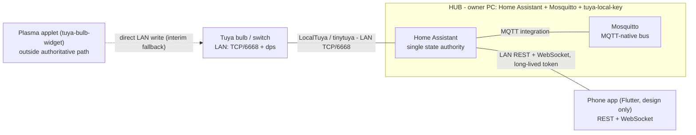

# Project Overview

## Problem

The owner wants private, self-hosted control of his home IoT that does not depend on a corporate cloud, running on hardware he already owns. Day-to-day operation - turning lights on, reading state, running automations - must keep working when the vendor cloud is unreachable, and no daily flow may require a third-party account beyond the one-time provisioning that Tuya hardware itself mandates.

## Solution

The Daver home system is a self-hosted, private home-IoT ecosystem. The owner's PC is the always-on server, the phone is the central controller, and nothing day-to-day depends on a corporate cloud. The hub is **Home Assistant + Eclipse Mosquitto** on the PC. The devices are existing Tuya hardware already paired in the Smart Life app - no reflashing, no new firmware, no SoftAP/BLE pairing. Two existing projects are reused unmodified as components: `tuya-local-key` (harvests and maintains Tuya local keys) and `tuya-bulb-widget` (an existing KDE Plasma desktop control surface).

### Corrected layer model

The owner's original sketch drew the Tuya devices as speaking MQTT to the server. They do not: over Wi-Fi they speak the **Tuya LAN protocol** (TCP/6668, dps-based; on/off on dp 1 or dp 20) and are driven by Home Assistant through the **LocalTuya** integration (tinytuya underneath). MQTT is the *hub-internal* bus - it carries MQTT-native devices and future extensions, never the Tuya bulbs. This is the one correction to the original sketch, recorded in [[adr-0003-tuya-lan-protocol-over-mqtt-device-leg]].

### Component inventory

| # | Component | Role | Runs on |
| --- | --- | --- | --- |
| C1 | Home Assistant Container | Single state authority: entities, recorder (SQLite), automations, REST + WebSocket API | Owner's PC (Docker) |
| C2 | Eclipse Mosquitto | Hub-internal MQTT bus for MQTT-native devices and extensions | Owner's PC (Docker) |
| C3 | tuya-local-key | Harvests and maintains Tuya local keys (occasional, cloud-touching) | Owner's PC (Docker) |
| C4 | tuya-bulb-widget | Provisioning/inspection evidence plus interim desktop fallback, outside the authoritative path | Owner PC (Plasma applet) |
| C5 | Phone/desktop app (Flutter, design only) | Thin Home Assistant client: REST commands + WebSocket live state | Phone / desktop |
| C6 | This repo | The design corpus now; `deploy/` compose manifests later | n/a |

### State ownership

Home Assistant entity state is the **single source of truth**. Mosquitto holds MQTT-native device state only, and Home Assistant publishes and consumes it through the MQTT integration, so everything the app can see is a Home Assistant entity. The app is stateless: it is a view plus commands over Home Assistant.

## When to use

- To orient yourself in the corpus before reading any other doc.
- To check what is in scope now (architecture design and documentation) versus later (a runnable deployment).
- To decide whether a new device or idea fits the ecosystem.

## When not to use

- For hub topology, ports, stack rationale, and the risk register - see [[hosting-architecture]].
- For the hub's internals and operations - see [[home-assistant-hub]].
- For the MQTT contract - see [[mqtt-topic-map]].
- For adding a device, see [add-a-tuya-device](../protocols/add-a-tuya-device.md).

## Examples

1. **Turn a bulb on from the phone.** The app sends `POST /api/services/light/turn_on` to Home Assistant with the entity id and a long-lived access token. Home Assistant writes the device over the LAN through LocalTuya; the resulting `state_changed` event reaches the app over its WebSocket subscription. The app stores no state of its own.

2. **A wall switch drives a bulb through the hub.** A Tuya wall switch sits on the LAN like any other device. A Home Assistant automation mirrors the switch's channel to the matching light entity - channel-authoritative and write-on-delta, the semantics inherited from the widget's link rules ([[tuya-bulb-widget-integration]]). The command path is Home Assistant -> LocalTuya -> bulb; the app only observes the resulting state.

3. **A local key rotation alert arrives.** A refresh in tuya-local-key finds that a device's local key has silently rotated, so LocalTuya can no longer reach it. The owner refreshes in tuya-local-key and re-enters the new key; see [[provisioning-flow]] and [[troubleshooting]].

## Common mistakes

- Reading the original sketch literally and wiring the Tuya bulbs to MQTT - they speak the Tuya LAN protocol and are reached through LocalTuya ([[adr-0003-tuya-lan-protocol-over-mqtt-device-leg]]).
- Treating this as a Flutter or backend implementation project - the deliverable now is architecture plus documentation; there is no runnable code.
- Assuming the Tuya cloud is never touched - provisioning and local-key rotation are the two exceptions; day-to-day control is LAN-only.

## References

- [hosting-architecture](hosting-architecture.md)
- [home-assistant-hub](home-assistant-hub.md)
- [provisioning-flow](provisioning-flow.md)
- [troubleshooting](troubleshooting.md)
- [project](../project.md)
