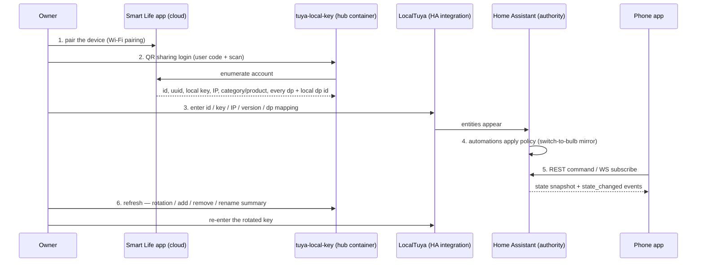

# Provisioning Flow

## Problem

A Tuya device only becomes part of the ecosystem after several distinct steps run in a fixed order, across three different systems (Tuya's cloud, the hub's LocalTuya config, Home Assistant). The steps look like a one-time setup, but credential maintenance recurs forever: Tuya silently rotates a device's local key on re-pair and sometimes after a firmware update, and local control breaks until the key is re-entered. The flow must be documented as a **recurring loop**, with each hand-off explicit about what data crosses which boundary.

## Solution

### Sequence



### Steps in prose

1. **Pair in Smart Life.** The only cloud step for control. The device joins Wi-Fi and is registered to the Tuya account.
2. **Harvest credentials.** tuya-local-key's QR sharing login enumerates the account and yields, per device: id, uuid, local key, IP, category and product, online status, and **every data point with its local dp id**. See [[tuya-local-key-integration]].
3. **Configure LocalTuya.** Those values go into LocalTuya on the hub; entities appear in Home Assistant. The dp mapping comes from step 2 — never guessed.
4. **Home Assistant becomes the authority.** Entities are recorded; automations apply policy (for example the switch→bulb mirror that replaces the widget's `link watch`). See [[home-assistant-hub]].
5. **The app consumes HA.** Commands via REST, live state via WebSocket. See [[mobile-app-design]].
6. **Maintenance loop.** Refresh in tuya-local-key, read the change summary, re-enter any rotated key into LocalTuya. Repeat for as long as the ecosystem lives.

### Data-flow table

| Step | What crosses | Boundary | Direction | Frequency |
|---|---|---|---|---|
| 1 | Device enrolment, Wi-Fi credentials | Owner → Tuya cloud → device | out | once per device |
| 2 | Account enumeration | tuya-local-key → Tuya cloud | out/in | on login and each refresh |
| 2 | id / uuid / local key / IP / category / product / dps + local dp ids | tuya-local-key → LocalTuya config | in | once per device, again on rotation |
| 4 | dp reads and writes (TCP/6668) | HA / LocalTuya ↔ Tuya device | in/out | continuous (poll + command) |
| 4 | MQTT topics | HA ↔ Mosquitto (hub-internal) | in/out | on MQTT-native devices only |
| 5 | `Authorization: Bearer` REST calls, `state_changed` events | Phone app ↔ HA | in/out | per command / live |
| 6 | Rotation / add / remove / rename summary | tuya-local-key → Owner | out | per refresh, forever |

### Cloud-touching moments

| Moment | Why the cloud | Repeats |
|---|---|---|
| Smart Life pairing | Tuya's account owns enrolment | once per device |
| Sharing login (QR) | account enumeration / key harvest | rarely (session cached) |
| Key rotation recovery | re-harvest the rotated key | whenever Tuya rotates silently |

**LAN-only rule:** everything else — control, state, automations, app traffic, MQTT — stays inside the home LAN. The cloud is never in the control path; see [[security-and-privacy]].

## When to use

- Onboarding a new Tuya device into the hub.
- Diagnosing why a previously working device stopped responding (rotation loop, step 6).

## When not to use

- For the tool's configuration and exposure details — see [[tuya-local-key-integration]].
- For the hub's own bring-up — see [bring-up-the-hub](../protocols/bring-up-the-hub.md).
- For the step-by-step by-device procedure — see [add-a-tuya-device](../protocols/add-a-tuya-device.md).

## Examples

```text
1. Smart Life: + → add device → Wi-Fi pairing → device appears in the app
2. tuya-local-key web UI: log in with the user code + QR → Refresh
3. Read the device panel: id, local key, IP, category, dp list with local dp ids
4. LocalTuya: add device → id + local key + IP + protocol version + dp mapping
5. HA: entity appears (light.<room>_<device>) → add it to an automation
6. Later: tuya-local-key Refresh → summary says "local key changed" → re-enter it in LocalTuya
```

## Common mistakes

- **Treating provisioning as one-time.** The key-rotation loop never ends; a device that worked for months can stop tonight without a config change.
- **Guessing the dp.** A two-channel switch is not reliably `dp 1`/`dp 2`. Read the dp evidence from the enumeration (and the widget's dp inspection) before writing LocalTuya config.
- **Letting the wallet of keys live only in LocalTuya.** With no rotation detection, a silent rotation is discovered by a dead bulb. tuya-local-key's change summary is the surveillance that makes the loop survivable.
- **Recording a harvested key in a doc, an issue, or git.** Keys live in config and encrypted caches; the corpus validator blocks them; see [[security-and-privacy]].

## References

- [tuya-local-key-integration](tuya-local-key-integration.md) — the harvest and rotation-surveillance tool.
- [home-assistant-hub](home-assistant-hub.md) — the authority the values feed.
- [mobile-app-design](mobile-app-design.md) — where the phone enters the flow.
- [security-and-privacy](security-and-privacy.md) — what crosses the LAN boundary and when the cloud is involved.
- [adr-0003-tuya-lan-protocol-over-mqtt-device-leg](../../adrs/adr-0003-tuya-lan-protocol-over-mqtt-device-leg.md) — why the device leg is LAN, not MQTT.
